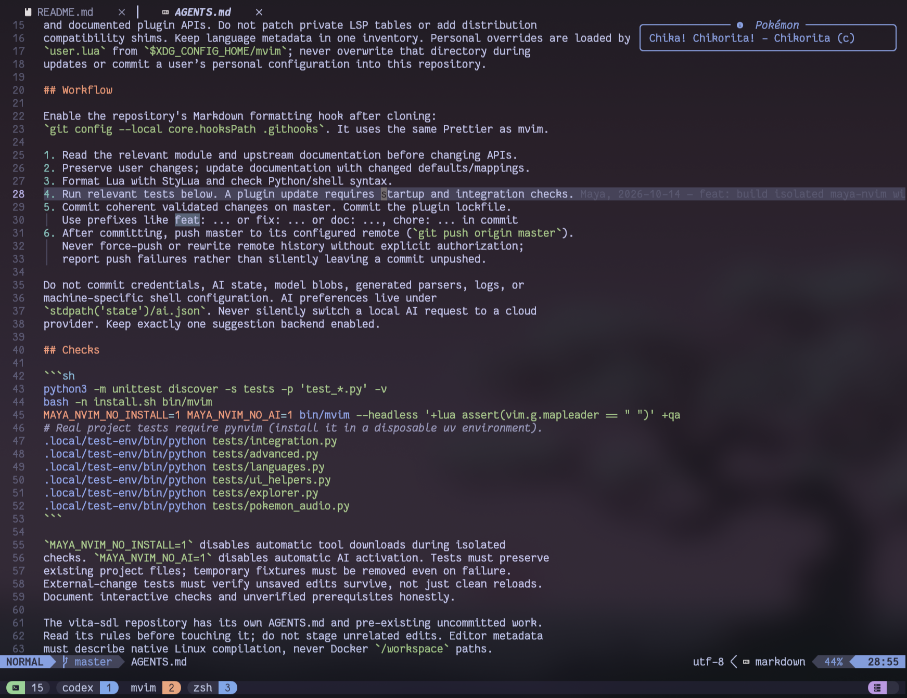

# 🌙 maya-nvim

Hi. I'm Maya and it's my Neovim config/distro. 🎀
I wanted to build something simple and familiar to use, but also modern, fast, flexible, and
with local type aware AI suggestions (optional but recommended, it uses many custom context collection improvements).

## 🌟 Features

It's standalone Neovim 0.12.5+ setup for Mac and Linux with an **easy installation**. Inspired by **LunarVim**,
uses transparent **Catppuccin Frappé**, modern language tools, **local type aware AI** (optional), and
**safe collaboration** with **external editors** such as Codex or Claude Code.
You can define your custom configs at `~/.config/mvim/init.lua`.

Launch with **`mvim`**. Isolated from other nvim distros.

Installation is one command, with guided questions and automatic setup of missing
prerequisites and instructions for conflicts.

## 🌸 Install

Supported systems: **Fedora, Debian/Ubuntu, Arch, openSUSE,** and **macOS with
Homebrew**. Must work on both **x86-64** and **ARM64**.

**One-command installation** (clones into `~/maya-nvim`, or updates if ran again):

```sh
bash -c "$(curl -fsSL https://raw.githubusercontent.com/unkindypie/maya-nvim/master/bootstrap.sh)"
```

The command itself needs Bash and curl. The bootstrap can install missing prerequisites or shows install command on failure.
System packages may require a sudo password. **Homebrew on macOS must already be installed.**

To chagnge install dir add this at the start of the install command
(before `bash ` separated by a space):
`MAYA_NVIM_INSTALL_DIR="$HOME/your_path/maya-nvim"`

Alternatively, clone this repository anywhere (Maya uses `~/maya-nvim`), then run:

```sh
./install.sh
```

Launch your new maya-nvim:

```sh
mvim
```



The installer links the repository into `${XDG_CONFIG_HOME:-~/.config}/maya-nvim`,
installs the launcher under `~/.local/bin` and an executable symlink under
`~/.local/libexec/maya-nvim` (so tmux displays `mvim`), adds a managed zsh alias, restores
locked plugins, installs language tools/parsers and debug adapters, and optionally sets up
local Ollama after asking. Only missing prerequisites are installed, after showing
the commands; package managers may update dependencies needed by those packages.
Open a new zsh
session afterwards, or run `~/.local/bin/mvim` immediately.

Missing tools install automatically; see [prerequisites and versions](docs/PREREQUISITES.md#prerequisites-and-versions) for details and manual fallback commands.

See [installer options](docs/PREREQUISITES.md#installer-options) for custom setup, AI choices, and update controls, or run:

```sh
./install.sh --help
```

Rerun the installer to update the same checkout and repeat setup; your personal configuration is preserved.

## 💫 Personal configuration

Use `~/.config/mvim/init.lua` to extend the managed configuration without editing
this repository (`$XDG_CONFIG_HOME/mvim` when XDG_CONFIG_HOME is set). Installation
creates a commented example if the file does not already exist. `Space Mc`
opens it. `Space Mu` pulls the latest maya-nvim changes and synchronizes plugins
from the new configuration, with visible progress and a completion result.
`Space MU` shows the last result; `:MayaUpdateLog` opens detailed update logs.

```lua
---@type MayaConfig
return {
  theme = "catppuccin/nvim", -- Optional; defaults to our transparent Catppuccin Frappé.
  theme_background = "auto", -- "dark" or "light"; "auto" preserves existing behavior.
  transparent_background = false, -- Keep the theme's own background behavior.
  codex_ide_context = false, -- Optional native Codex CLI /ide context bridge.
  pokemon_sound_on_start = true, -- Play a Pokémon cry.
  pokemon_sound_on_start_volume_percentage = 50, -- 0–100; 0 mutes playback.
  reopen_tabs = true, -- Restore this folder's files, tabs, and splits.
  ai_completion_debounce_ms = 50, -- Insert-mode completion idle delay.
  ai_next_edit_debounce_ms = 50, -- Local AI idle delay.

  options = {}, -- No personal editor-option overrides.

  plugins = {}, -- No personal plugin additions or overrides.

  setup = function()
    -- No custom setup by default; add keybindings or other setup here.
  end,
}
```

The example includes every `MayaConfig` setting at its default behavior. `options`,
`plugins`, and `setup` are omitted by default; the empty values above have the same
effect. All settings are optional.

For native editor context in your existing Codex CLI, set
`codex_ide_context = true`, restart mvim, then run `/ide` in Codex in the same
project. `Space ai` shows connection status. See [Codex IDE context](docs/CODEX.md)
for setup, limits and compatibility.

`theme` is optional. Omitting it keeps the current transparent Catppuccin Frappé.
New installations include `theme = "catppuccin/nvim"`; existing configs are preserved.
Set `theme_background = "dark",` or `theme_background = "light",` in
`~/.config/mvim/init.lua` and restart mvim to select a variant. The default
`"auto"` preserves existing behavior. The selected theme must support that variant;
the setting does not recolor themes that only provide one variant. An existing
`options.background` override takes precedence.

Add `transparent_background = true,` to your personal configuration to show the
terminal background with any theme, including editor gutters and floating windows.
It reapplies after colorscheme changes and preserves foreground colors and styles.
Omitting it or setting it to `false` keeps the theme's own behavior. Selected-line,
tab and statusline backgrounds remain theme-controlled for readability.
Catppuccin is the only bundled theme. To use another theme, enter its actual
GitHub repository (`owner/repository`), for example:

```lua
theme = "folke/tokyonight.nvim",
```

Only the selected repository is installed, if missing. The colorscheme name is
inferred from the repository name (for example, `tokyonight.nvim` → `tokyonight`).
If its colorscheme has a different name or you want to extend its settings, use:

```lua
theme = {
  plugin = "author/theme.nvim",
  name = "my-colorscheme",
  module = "theme", -- Include the setup module when supplying opts.
  opts = {},
},
```

To extend the default theme:

```lua
theme = {
  plugin = "catppuccin/nvim",
  name = "catppuccin-frappe",
  opts = { transparent_background = false },
},
```

Restart to apply. The status line follows the selected theme, and extra theme
plugin pins use your personal lockfile. Built-in Neovim colorscheme names such
as `"habamax"` work without downloading anything. Unknown colorscheme names
fall back to Catppuccin with a notification.

Use lowercase `true` / `false`. The installer asks about sound and tab restoration
when creating a new config; reinstalling preserves your existing file.

Options and `setup()` run after the built-in defaults/keymaps. Plugin specs are
merged after the built-in specs, so they can add plugins, override `opts`, or
use `enabled = false`. For larger setups, put modules in `lua/mvim/` and use
`require("mvim.name")`, or import plugin specs with `{ import = "mvim.plugins" }`.
Personal `ftplugin/` and `after/` directories are supported too. Restart mvim to
apply changes. Configuration errors are reported without discarding defaults.

When personal plugin specs or theme extensions are present, their lockfile is
`~/.config/mvim/lazy-lock.json`, initially copied from the repository's lockfile.
It is independent afterwards: plugin updates/restore use that local lockfile.
To adopt newer repository pins, back up or remove the personal lockfile and
restart; it will be seeded again. A read-only personal directory uses a lockfile
in maya-nvim's state directory instead. Keep personal config and locks when
uninstalling unless you explicitly want to remove them.

Buffer tabs follow the active light/dark colorscheme, with a distinct selected tab
and vertical separators. Styling refreshes on live theme changes and works with
transparent editor backgrounds; no personal bufferline color overrides are needed.
Hidden and ignored explorer entries also use theme colors; ignored paths are italic.

## 🌟 Daily use

Press Space for which-key. `Space f` finds files, `Space e` opens the explorer,
`Space st` searches text, and `Space w` saves. `H`/`L` switch buffers;
`Space c` closes one and `Space bo` closes all others.

Files format on save and reload after external changes; unsaved edits use native
conflict handling. Launching `mvim` without file arguments restores the folder's
saved files and tabs when enabled.

See [keybindings](docs/KEYBINDINGS.md), [language tools](docs/LANGUAGES.md), and
[sessions and troubleshooting](docs/MAINTENANCE.md) for more.

## 🌺 AI suggestions

**Cursortab runs one local model for inline completions and next edits**, using
Maya's cached LSP type context. No cloud account or paid API is needed. The installer
builds Cursortab and sets up Ollama with one model:

| Dedicated VRAM     | Model choice                                          |
| ------------------ | ----------------------------------------------------- |
| 2 GB+              | Sweep 1.5B Q8 (default; 2 GB may require CPU offload) |
| 8 GB+ alternatives | Zeta-2.1 or Zeta-2 8B Q4_K_M                          |

Memory needs depend on context length and other GPU use; setup checks residency.
Use `Space ao` to enable/reload local AI, `Space ax` to turn AI off, and `Space as`
for status. **Tab accepts**, `Ctrl-]` dismisses until the next edit, and `Space an`
requests a suggestion. Selected ordinary editor completions take priority.
`Space am` opens saved AI settings. `Ctrl-L` / `Alt-[` also request a suggestion.

Copilot uses the same Cursortab engine as an opt-in cloud provider (`Space ac`, then `:LspCopilotSignIn`).
A local server failure never switches to a cloud provider.
See [AI setup and migration](docs/AI.md) and [measured quality and speed](docs/AI_CANDIDATES.md).

Review Git changes in a directory tree with `Space gv` (Diffview). Use `Space gV`
to compare a branch or revision such as `origin/main...HEAD`, and `Space gq` to
close the view. Fetch remote refs first when needed. Lazygit remains on `Space gs`.

## 🌠 Configuration map

| Location                 | Responsibility                                      |
| ------------------------ | --------------------------------------------------- |
| `init.lua`               | Small ordered entry point                           |
| `lua/maya/options.lua`   | Editor defaults and safe config-file indentation    |
| `lua/maya/keymaps.lua`   | Familiar global bindings and which-key descriptions |
| `lua/maya/plugins/`      | Plugin choices grouped by UI, completion, and tools |
| `lua/maya/languages.lua` | LSP setup and first-use tool/parser inventory       |
| `lua/maya/ai.lua`        | Provider switching and shared suggestion controls   |
| `lua/maya/pokemon.lua`   | Local dashboard sound bank                          |
| `lua/maya/session.lua`   | Native folder session save/restore                  |
| `lua/maya/reload.lua`    | Native file-change checks and disk diff             |
| `lua/maya/debug.lua`     | Python and Node debug adapters                      |
| `scripts/`               | Installer, bootstrap, and Ollama setup              |
| `tests/`                 | Installer and real editor integration checks        |

## 🌟 Updates and removal

Plugin revisions are recorded in `lazy-lock.json`. Review and test updates before
committing the lockfile on `master`. See [maintenance](docs/MAINTENANCE.md) for
rollback, tool versions, testing, and complete uninstall instructions. Removing
maya-nvim never requires deleting LunarVim or Ollama models.

Configuration licensed GPL-3.0; LunarVim-derived mappings are attributed in
[NOTICE](NOTICE). Plugins retain their own licenses.

## Backlog / TODO

- Add cross-platform desktop light/dark detection, with Linux desktop and macOS
  support, live updates, and a safe fallback. The current personal Maya watcher
  reads `~/.config/maya-theme/current`; built-in `theme_background = "auto"`
  preserves Neovim's existing background rather than detecting the desktop.
- Add shared Codex/OpenCode task controls using Codex app-server and OpenCode's
  server API: task/session picker, live status and notifications, explicit sending
  of selections/files/diagnostics to a chosen task, and a worktree picker that
  opens changes in Diffview. Reuse Snacks and lualine. First verify access to
  existing running CLI sessions without taking them over; identify targets by
  server, workspace and task/session ID. Reuse Maya's Visual-mode selection
  capture, including unsaved selected text, and keep adding context to a draft
  separate from submitting a request. Preserve the existing Codex IDE bridge;
  OpenCode selection sharing still needs implementation and validation.
