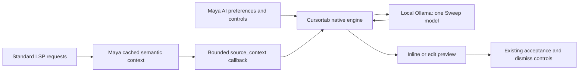

# Local AI candidate evaluation — stages 1 and 2

Review checkpoint requested on 29 October 2026. This work evaluates Cursortab
against the bundled blink-edit with local models. It does not change the active
plugins, saved preferences, keymaps, or runtime architecture.

The target remains **one local plugin and one active local model for both inline
completion and next-edit prediction**, preserving Maya's cached, capability-based
LSP context. Copilot remains a separate opt-in feature.

<!-- candidate-results-start -->

## Stage 2: primary results and recommendation

**Prefer Cursortab as the target architecture, but do not switch the runtime yet.**
It has the stronger maintenance outlook and much better insertion latency.
The agreed correction and abstention gates remain unmet; maintenance does not
silently waive those gates. Blink meets the quality comparison here but misses
the insertion latency target on larger files.

The primary comparison and baseline contain 1,980 observations across 60 fixtures
and three configurations. Tables exclude the first observation of each fixture,
leaving ten warm repetitions. Repetitions are not independent quality tasks.

| Configuration         | Insertion correctness | Correction correctness | Genuine no-preview abstention |
| --------------------- | --------------------- | ---------------------- | ----------------------------- |
| Current dual baseline | 149/240 (62.1%)       | 130/180 (72.2%)        | 180/180 (100.0%)              |
| blink-edit + Sweep    | 212/240 (88.3%)       | 133/180 (73.9%)        | 180/180 (100.0%)              |
| Cursortab + Sweep     | 227/240 (94.6%)       | 119/180 (66.1%)        | 170/180 (94.4%)               |

Correctness is the predefined structural score after one public accept operation,
not a broad claim about coding ability. Native parsing, filtering and viewport
limits are part of the measured plugin/model combination.

| Configuration         | Insertion first-preview p95 | Insertion correct-preview p95 | Correction correct-preview p95 |
| --------------------- | --------------------------- | ----------------------------- | ------------------------------ |
| Current dual baseline | 1,061 ms                    | 899 ms                        | 917 ms                         |
| blink-edit + Sweep    | 2,674 ms                    | 2,680 ms                      | 988 ms                         |
| Cursortab + Sweep     | 458 ms                      | 468 ms                        | 958 ms                         |

These are **controlled warm request timings**, including the fixed 200 ms Insert
or 650 ms Normal pause. A correct-preview measurement waits for the useful response
to finish and requires the accepted result to match the fixture. Wrong or absent
predictions remain failures in the quality denominators. The machine-readable
[results](AI_CANDIDATE_RESULTS.json) also retain all-outcome latency, request counts,
unchanged outputs and unshown-response categories.

Both candidates were correct on the three larger-file insertion fixtures.
For example, the Python case had median first-preview latency of 2,382 ms for
Blink versus 379 ms for Cursortab; Lua was 2,690 ms versus 370 ms. Blink regenerated
roughly 397/520 response characters in those cases, while Cursortab generated
roughly 34/22. This supports response prefill as a major explanation for the speed
difference; it is not evidence that streaming alone explains it.

### Held-out results

Each cell covers six held-out fixtures with ten repetitions each. These fixtures
were excluded from the context-budget and streaming experiments.

| Configuration         | Insertions     | Corrections   | No-preview abstention |
| --------------------- | -------------- | ------------- | --------------------- |
| Current dual baseline | 33/60 (55.0%)  | 30/60 (50.0%) | 60/60 (100.0%)        |
| blink-edit + Sweep    | 60/60 (100.0%) | 40/60 (66.7%) | 60/60 (100.0%)        |
| Cursortab + Sweep     | 60/60 (100.0%) | 30/60 (50.0%) | 60/60 (100.0%)        |

### Gates and failure interpretation

- Cursortab passes the 500 ms insertion and 1 s correction latency targets, and
  improves insertion correctness over the current dual baseline.
- Its correction score is 119/180 versus the baseline's 130/180. Its abstention
  score is 94.4%, below the 95% target. Both block an automatic migration.
- Blink exceeds the baseline's correctness scores and reaches 100% abstention,
  but its insertion p95 is far above 500 ms.
- No timeouts or overlapping pre-accept requests were observed in these runs.
  Twenty warm Cursortab requests recorded connection resets on the larger Python
  insertion/quiet fixtures; every corresponding accepted or unchanged buffer was
  correct. Captured output and the streaming path are consistent with intentional
  early termination. These are reported separately as transport disconnects, not
  hidden in a zero-error claim. The final capture helper distinguishes client
  write disconnects from upstream failures.

Representative failures matter more than a single combined score:

- Blink sometimes completed a Lua return expression without supplying the missing
  closing end.
- Cursortab sometimes kept a misspelled method unchanged, or changed the misspelled
  table.lenght to the still-invalid table.length instead of Lua's length operator.
- Both sometimes replaced the required literal local with normal.
- Cursortab consistently proposed an extra subtract function in one completed Lua
  function fixture, accounting for its abstention failure.
- The dual baseline sometimes copied LSP documentation into FIM completions.
  Its results cannot be compared directly with the earlier no-LSP benchmark.
- Some strict misses are harmless alternatives such as sum(values, start=0).
  The predefined answers were not changed after observing outputs.

<!-- candidate-results-end -->

<!-- focused-results-start -->

### Focused experiments and final settings

The context-budget and streaming experiments used only development fixtures.
No held-out fixture was used to tune their settings.

| Experiment                              | Candidate | Full-context correctness → experiment | Correct-preview p95: baseline → experiment |
| --------------------------------------- | --------- | ------------------------------------- | ------------------------------------------ |
| 2,000-byte insertion context            | blink     | 60/60 → 50/60                         | 457 ms → 371 ms                            |
| 2,000-byte insertion context            | cursortab | 60/60 → 60/60                         | 474 ms → 330 ms                            |
| 2,000-byte correction context           | blink     | 43/60 → 50/60                         | 882 ms → 821 ms                            |
| 2,000-byte correction context           | cursortab | 50/60 → 50/60                         | 810 ms → 782 ms                            |
| Buffer streamed response until complete | cursortab | 60/60 → 60/60                         | 474 ms → 433 ms                            |

**Keep the 6,000-byte cached-context limit and native streaming for the next
iteration.** The smaller cap failed the real-LSP contract: Lua type documentation
required by the existing feature was absent from the actual HTTP prompt. A speed
or score gain on small fixtures cannot justify that loss. The collector itself
was not changed. Buffering is an experiment at the capture proxy, not a supported
Cursortab nonstreaming configuration. Its roughly 9% p95 difference on six short
fixtures, with unchanged correctness, is not enough evidence to add a buffering
layer. The primary large-file speed gain is much larger and aligns with reduced
response generation.

### Native typing smoke test

This separate run used genuine input, a saved initial checkpoint, native history
and scheduling, and no attached LSP. It covers nine original fixtures with three
repetitions each. It is not directly interchangeable with the larger real-LSP
controlled benchmark.

| Candidate | Insertions | Corrections | No-preview abstention |
| --------- | ---------- | ----------- | --------------------- |
| blink     | 6/9        | 9/9         | 8/9                   |
| cursortab | 9/9        | 9/9         | 3/9                   |

The native smoke test makes the abstention gap more concerning, rather than
overriding it with the favorable controlled latency result. Cursortab's text-change
timer can survive leaving Insert mode, so a post-typing Normal-mode prediction
uses about the 200 ms typing pause in this scenario; the 650 ms setting is its
idle delay. Blink's Normal-mode path uses its separate delay. These timings are
therefore not a matched-delay comparison.

The deterministic version of the same native-event test passes all 18
candidate/fixture combinations. This distinguishes model/prompt behavior from a
failure of the event harness or acceptance operation.

### Cold-model probe

After unloading only the temporary Sweep alias, one Python insertion probe took
2,735 ms with Blink and 2,593 ms with Cursortab to show the first preview.
Their immediately repeated warm requests took 360 ms and 275 ms respectively.
Both answers were correct. This is one cold observation per candidate, not a cold
p95 estimate; keeping the model resident matters more than plugin overhead at
startup. The benchmark alias was temporary and the original model was preserved.

### Validation

- 75 repository unit tests; Python formatting/lint and shell syntax checks.
- Isolated Neovim startup through bin/mvim with the required application name.
- Cursortab Go tests across 21 tested packages, including the new hook contracts.
- Captured cached-context, byte-bound, callback-error, cancellation, unsaved-edit,
  and Markdown prefix/suffix checks for both candidates.
- Six real-LSP context fixtures through Cursortab at the retained 6,000-byte limit;
  the smaller-limit failure above is an intentional rejected experiment.
- All 18 deterministic native-event candidate/fixture combinations.
- Existing shared-context and Markdown regression checks.

Kitty/tmux interaction, acceptance-key arbitration, undo behavior and the complete
provider-switching migration are stage 3/4 work, not claimed as validated here.

### Review outcome

Stages 1 and 2 are complete; runtime migration is intentionally stopped.
Cursortab remains the recommended target because of its native efficient prompt
path and upstream maintenance. The next approved work should address correction
quality and unwanted follow-on predictions while retaining required semantic
context, then verify fresh-buffer activation and a supported prefetch control.
Do not remove the current local engines or relax the stated gates silently.
<!-- focused-results-end -->

## Revised stages and decision rules

1. **Feasibility and experiment preparation:** pin sources and model, build in a
   disposable checkout, verify local API/streaming and cached LSP context, check
   stale-response handling, and preregister an expanded corpus.
2. **Comparison and tuning:** compare both candidates on the same local model,
   repeat warm trials, separate correctness from preview speed, test native typing,
   and inspect maintenance costs. Change one factor at a time on development cases.
   Stop here for review.
3. **After review:** integrate the selected engine behind existing AI controls.
   Keep the collector; delegate scheduling, requests, cancellation and preview
   ownership to the plugin. Migrate affected settings without retaining a second
   local plugin permanently.
4. **After integration:** repeat quality/latency experiments, exercise acceptance,
   undo, dismiss, provider switching and Kitty/tmux interaction, then remove obsolete
   code. No stage 3 or 4 runtime changes are included here.

The balanced targets are insertion p95 ≤500 ms, Normal-mode edit p95 ≤1 s,
correctness at least equal to the dual baseline separately for insertions and
edits on the **same corpus**, and at least 95% genuine no-preview abstention.
Stale/destructive application, competing inference or loss of unsaved edits fails
the migration gate regardless of speed. Repeated synthetic trials do not establish
general model quality.

Future maintenance is an explicit selection factor. With comparable local
quality and speed, prefer Cursortab's maintained native engine rather than adding
more Maya-specific scheduling and transport code. Do not select blink-edit merely
because it is pure Lua. Failed quality or safety gates still block migration.

## Stage 1: feasibility

Cursortab works with the installed local Ollama server through /v1/completions,
including streaming. No cloud account or inference service is involved.
Its native Sweep prompt uses a cursor marker and response prefill. Blink uses
Ollama's /api/generate and a nonstreaming replacement window.

The disposable Cursortab checkout needs a small optional source_context callback
extension to retain Maya's collector. The included patch reads at most
6,000 bytes in the existing atomic buffer snapshot, rejects callback errors or
changes to buffer/tick/cursor, carries text through the normal snapshot, and adds
a Sweep context section. Synthetic prefetch snapshots omit this cursor-specific
text. Scheduling, transport, inference and rendering are unchanged.

The patch and original MIT license live in [tests/fixtures](../tests/fixtures/). They are evaluation
inputs, not installed plugins. No Go binary, model weights or upstream Git history
is bundled. A maintained upstream callback would be preferable to a permanent
private patch.

Verified with real Neovim and captured HTTP requests:

- Lua, Python and TypeScript cross-file types, member documentation and incomplete
  annotated values reach Cursortab's prompt through the existing collector.
- An edit invalidates cached context; the stale text is omitted.
- Cancellation prevents a delayed reply from reviving a preview and preserves an
  unsaved edit.
- Cursortab's Go suite passes, including added prompt and synthetic-snapshot tests.
- Existing shared-context and Markdown regressions remain covered.

An API compatibility trap was caught before measurements: Cursortab's
context_size=4096 is an input-trimming setting, not an Ollama server option.
Without a model-level setting, Ollama used 2,048 tokens for its OpenAI route while
Blink requested 4,096. The experiments use a temporary alias of the same Sweep
weights with num_ctx=4096; /api/ps confirmed 4,096 for both routes.

## Reproducible environment

| Component                            | Evaluated version                                                        |
| ------------------------------------ | ------------------------------------------------------------------------ |
| Cursortab                            | 211f7159ecc9ec56c705cf5a486637f1221ad2fd plus the included context patch |
| blink-edit                           | Bundled tree in maya-nvim ff0e58e; provenance in vendor/README.md        |
| Model                                | hf.co/sweepai/sweep-next-edit-1.5B:Q8_0                                  |
| Original model digest                | e002e6eebb83f7070f2a8a8cb5036a298d245942e68e78b77659ca9b8b1bdc34         |
| Temporary 4,096-context alias digest | 20c1375343cd17b538f0ffbf5388664438b1c388a25ff457e070ac3a7bf51cd2         |
| Server                               | Ollama 0.40.4                                                            |
| GPU                                  | RTX 3060 Laptop, 6,144 MiB; driver 615.78.08                             |
| Build                                | Go 1.27.3; upstream requires Go 1.25+                                    |

Both candidates use Sweep, temperature 0, a 512-token output cap, a 4,096-token
server context and the same cached semantic collector. The primary trials apply
a controlled 200 ms Insert / 650 ms Normal delay before explicit requests.
This avoids confusing native no-change suppression with model quality.
**These are controlled request timings, not end-to-end typing latency.**
Native typing experiments are reported separately.

The corpus contains the original 24 cases plus 36 new cases, balanced across
Lua/Python/TypeScript and insertion/edit/quiet behavior. New cases include
mid-line suffixes, annotated values, cross-file types, multiline functions and
180-line files. Half of the new cases are held out from tuning. Real LSPs are
attached in the primary quality run; cached context is prepared before timing.
Each candidate gets a first observation and ten warm repetitions per case.
Candidate order alternates by fixture; GPU jobs run sequentially. The attached
editor UI is 110 columns by 35 rows; native viewport limits and filtering affect
the accepted results.
Plugin state is reset between repetitions. Cursor prediction is disabled in the
Cursortab trial and Blink prefetch is disabled. Cursortab has no independent
prefetch switch in this revision; request counts and overlaps are observed, but
this does not prove speculative inference is globally disabled. A supported
switch or a small reviewed extension is needed before promising Maya's strict
preview-ownership policy for every multistage interaction. The native typing smoke test types a
short suffix through actual editor input, with automatic pairs disabled to keep
the source fixed. It establishes the already-saved fixture checkpoint before
timing: without that checkpoint, Cursortab's first sync can treat the first edit
as the initial contents and suppress the request. Fresh-buffer activation must
therefore be checked during integration.

The candidates retain their native prompt construction, context windows and
streaming behavior, so this is a comparison of usable plugin/model combinations,
not an isolated model or identical-prompt comparison. The larger Cursortab prompt
can consume more of the same server context budget. The current dual engine is a
baseline, not a candidate for the final architecture.

The scorer compares Python ASTs and Lua/TypeScript tokens, with preregistered
simple quote-style and statement-ending semicolon alternatives. It deliberately
penalizes extra statements and missing syntax. It is not a semantic-equivalence
proof: for example, sum(values, start=0) is valid but fails the predefined
sum(values) answer. Such cases must be described alongside the strict score,
without changing the primary answers after seeing results.

A quiet case passes only if the buffer stays correct **and no preview appears**.
First preview, fully received correct preview, request duration and all-outcome
latency are separate measurements. The all-outcome measurement includes a 120 ms
settlement observation; the safe-preview metric excludes that padding. Acceptance
uses the plugin's public operation. Requests launched after acceptance are counted
separately. The report also distinguishes empty responses, model text that
repeats the current window, and nonempty changed text that was not shown. The last
category is not automatically a model error: plugin filtering can be desirable.

## Maintenance assessment

Cursortab is the stronger long-term maintenance candidate. Its evaluated upstream
commit is dated 29 October 2026; blink-edit's latest upstream commit is
220f5777f5597f6d7868981d6ff9b6218247fec4, dated 1 February 2026.
Cursortab has native streaming, model-specific prompts, cancellation/state
machinery and an extensive Go test suite. Blink's bundled fork already carries
Maya-specific coordination, cancellation, filtering and context changes.
Activity is evidence of current support, not a guarantee of future maintenance.
See [Cursortab upstream](https://github.com/cursortab/cursortab.nvim) and
[blink-edit upstream](https://github.com/BlinkResearchLabs/blink-edit.nvim).

Cursortab's costs are a Go build/daemon and the small cached-context extension.
Ollama reported about 1.54 GiB of model VRAM for Sweep alone and 3.24 GiB
for the dual baseline with Qwen also resident, both at 4,096-token context.
These figures exclude other desktop GPU use.
One active sample measured 11,288 KiB for the daemon and 9,420 KiB for its client
process (about 20 MiB combined); this is a snapshot, not a peak-memory bound.
The later migration should aim to upstream that extension and keep Maya's adapter
limited to provider preferences, cached context, status and established keymaps.
A second home-grown scheduler would defeat the simplification goal.

## Reproduce

Use an unused disposable checkout and an installed Go toolchain, plus the existing
pynvim test environment. These commands do not change the active editor config.

```sh
export NVIM_APPNAME=maya-nvim MAYA_NVIM_NO_INSTALL=1 MAYA_NVIM_NO_AI=1
candidate_dir=$(mktemp -d /tmp/maya-cursortab-eval.XXXXXX)
git -C "$candidate_dir" init
git -C "$candidate_dir" fetch --depth 1 https://github.com/cursortab/cursortab.nvim.git \
  211f7159ecc9ec56c705cf5a486637f1221ad2fd
git -C "$candidate_dir" checkout --detach FETCH_HEAD
git -C "$candidate_dir" apply "$PWD/tests/fixtures/cursortab-context.patch"
(cd "$candidate_dir/server" && go test ./... && go build -o cursortab .)

.local/test-env/bin/python tests/ai_candidate_context.py --cursortab "$candidate_dir"
.local/test-env/bin/python tests/ai_shared_context.py --cursortab "$candidate_dir"
.local/test-env/bin/python tests/ai_candidate_typing.py --cursortab "$candidate_dir" \
  --fake --repetitions 1

# Use an unused alias name. This shares the existing model weights.
curl --fail http://127.0.0.1:11434/api/create -d \
  '{"model":"maya-sweep-candidate-eval","from":"hf.co/sweepai/sweep-next-edit-1.5B:Q8_0","parameters":{"num_ctx":4096},"stream":false}'
export MAYA_NVIM_BENCHMARK_MODEL=maya-sweep-candidate-eval MAYA_NVIM_TEST_OLLAMA=1
.local/test-env/bin/python tests/ai_candidates.py --cursortab "$candidate_dir" \
  --manual --repetitions 10 > /tmp/maya-candidates.jsonl
.local/test-env/bin/python tests/ai_candidate_report.py /tmp/maya-candidates.jsonl
# Run subsequent inference experiments sequentially, never alongside that run.
.local/test-env/bin/python tests/ai_candidates.py --cursortab "$candidate_dir" \
  --candidates dual --manual --repetitions 10 > /tmp/maya-dual-expanded.jsonl
.local/test-env/bin/python tests/ai_candidate_typing.py --cursortab "$candidate_dir" \
  > /tmp/maya-native-typing.jsonl
# Remove only the temporary alias when finished.
curl --fail -X DELETE http://127.0.0.1:11434/api/delete \
  -d '{"model":"maya-sweep-candidate-eval"}'
```

Raw requests, outputs, logs and build artifacts stay outside the repository.

## Architecture for review, not yet implemented

The proposed Cursortab integration keeps Maya's existing preferences and cached
semantic collector. Cursortab owns scheduling, requests, streaming, cancellation
and preview state. The adapter connects existing controls and acceptance mappings
to that lifecycle. Ordinary blink.cmp/LSP completion remains available.



Before removing the old local engines, the integration must prove AI-off/Copilot
handover cancels Cursortab, a visible preview remains stable, acceptance preserves
undo behavior, and no speculative request competes with an active request or
preview. Old local-mode preferences need a documented migration to the single
engine, rather than retaining a second implementation for compatibility.
